  
  
  
  
  
  

# 📁 Awesome Digital Asset Browser &amp; Organizer

**The definitive, SEO-optimized curated directory of high-performance Digital Asset Management (DAM) platforms, photo catalogers, RAW image viewers, AI-powered media libraries, and self-hosted organizers.**

---

## 📑 Table of Contents
- [🔍 Sector Overview &amp; Market Dynamics](#-sector-overview--market-dynamics)
- [☁️ SaaS &amp; Commercial Digital Asset Organizers](#️-saas--commercial-digital-asset-organizers)
- [🔓 Open-Source GitHub Projects](#-open-source-github-projects)
- [🛠️ Architectural Recommendations &amp; Workflows](#️-architectural-recommendations--workflows)
- [🤝 How to Contribute](#-how-to-contribute)
- [💖 Support &amp; Sponsoring](#-support--sponsoring)
- [📈 Star History](#-star-history)
- [📜 Disclaimer](#-disclaimer)

---

## 🔍 Sector Overview &amp; Market Dynamics

The global **Digital Asset Management (DAM)** and digital photo organizer market is valued at approximately **$5.3 billion to $5.8 billion** and is projected to expand to over **$11.5 billion** by 2030, driven by a compound annual growth rate (CAGR) of 13–15%. 

The sector exhibits **moderate fragmentation with a bifurcated competitive landscape**:
- **High-End Enterprise DAM** (e.g., Adobe, Bynder, Canto) leans toward oligopolistic concentration driven by deep enterprise MarTech, CMS, and Creative Cloud integrations.
- **Desktop &amp; Self-Hosted Asset Organization** remains highly fragmented with intense competition among specialized culling suites (ACDSee, FastStone, Eagle, Photo Mechanic) and a rapidly surging **open-source and self-hosted ecosystem** (Immich, PhotoPrism, digiKam, Ente) prioritizing privacy, AI local inference, and zero recurring vendor lock-in.

---

## ☁️ SaaS &amp; Commercial Digital Asset Organizers

The table below lists leading commercial and SaaS digital asset browser and management solutions, sorted descending by **Company Scale (Market Capitalization / Valuation / Annual Revenue)**:

| Product | Description | Company Scale (Revenue / Valuation) | Pricing | Free Tier / Free Trial Limits |
| :--- | :--- | :--- | :--- | :--- |
| **[Adobe Bridge](https://www.adobe.com/products/bridge.html)** | Centralized visual asset browser for creative workflows, metadata inspection, and batch renaming across Adobe Creative Cloud. | **~$240B Market Cap** *(Adobe Inc., ~$21.4B Annual Revenue)* | Free standalone desktop utility (Adobe CC plans start at $9.99/mo) | **100% Free Forever** desktop application (requires free Adobe ID account; includes 2 GB free Creative Cloud storage) |
| **[Adobe Lightroom](https://www.adobe.com/products/photoshop-lightroom.html)** | Cloud-synced and local photo organizer, non-destructive RAW processor, and AI-assisted cataloging environment. | **~$240B Market Cap** *(Adobe Inc., ~$21.4B Annual Revenue)* | $9.99/mo *(Lightroom Plan, 1 TB Cloud Storage)* | **7-day free trial** with full unrestricted access to all editing features and 1 TB cloud sync |
| **[Bynder](https://www.bynder.com/)** | Enterprise-grade SaaS digital asset management solution for marketing teams, brand compliance, and multi-channel asset distribution. | **~$600M Valuation** *(Acquired by Thomas H. Lee Partners; ~$100M ARR)* | Starts at $450/month *(Core starter deployment, billed annually)* | **14-day free trial** upon approval, limited to 5 test users and sample brand assets |
| **[Canto](https://www.canto.com/)** | Cloud-native DAM software enabling team collaboration, facial tagging, rights management, and media sharing. | **~$400M Valuation** *(Backed by Marlin Equity Partners; ~$60M ARR)* | Starts at $600/month *(Standard team tier, billed annually)* | **14-day free trial** available upon sales qualification with pre-loaded demo media library |
| **[ACDSee Photo Studio](https://www.acdsee.com/)** | High-performance Windows/Mac photo management suite with RAW development, face detection, and hierarchical tagging. | **~$50M - $100M Valuation** *(Sub. of ACD Systems / Canadian tech group)* | $8.90/mo or $89.90/yr *(Home Plan)*; perpetual license from $149.99 | **30-day free trial** with fully functional features and no watermarking |
| **[Photo Mechanic](https://home.camerabits.com/)** | The photojournalism industry-standard ingest and metadata tagging browser built for rapid culling of thousands of RAW files. | **~$15M - $30M Est. Valuation** *(Camera Bits Inc., Private)* | $14.99/mo *(Subscription)* or $399 one-time perpetual license | **30-day free trial** with 100% uncapped feature access across macOS and Windows |
| **[Mylio Photos](https://mylio.com/)** | Privacy-centric multi-device organizer that synchronizes personal image collections locally without third-party cloud storage. | **~$10M - $25M Est. Valuation** *(Mylio LLC, Venture-backed)* | $9.99/mo or $99/yr *(Mylio Photos+)* | **Free Forever Plan** limited to a single device and local library browsing without sync across devices |
| **[Eagle](https://eagle.cool/)** | Desktop digital asset manager tailored for designers, 3D artists, and illustrators to organize design inspiration, typography, and UI assets. | **~$10M - $20M Est. Valuation** *(OgDesign Inc., Bootstrapped profitable)* | $29.95 one-time perpetual license *(includes 2 desktop activations)* | **30-day free trial** with full capabilities and unlimited file imports |
| **[FastStone Image Viewer](https://www.faststone.org/)** | Ultra-lightweight, blazing-fast image browser, converter, and organizer engineered for rapid navigation of local directory structures. | **~$5M - $10M Est. Valuation** *(FastStone Soft, Independent)* | $34.95 one-time lifetime license for commercial use | **100% Free Forever** for non-commercial personal and educational use with zero feature restrictions |
| **[XnView MP](https://www.xnview.com/en/xnviewmp/)** | Versatile cross-platform media browser and batch batch-converter supporting over 500 file formats with cataloging and tagging capabilities. | **~$3M - $8M Est. Valuation** *(XnSoft, Pierre-Emmanuel Gougelet)* | €29.00 (~$31) one-time lifetime license for commercial operations | **100% Free Forever** for personal, non-profit, or private educational usage with complete toolset |

---

## 🔓 Open-Source GitHub Projects

Explore the most popular open-source and self-hosted digital asset managers, photo vaults, and cataloging utilities. Ranked in **descending order by GitHub stargazers**:

| Repository | GitHub Stars Badge | Description | Primary Stack | License |
| :--- | :---: | :--- | :--- | :--- |
| **[Immich](https://github.com/immich-app/immich)** |  | High-performance, self-hosted photo &amp; video backup suite with facial recognition, semantic CLIP search, and native mobile apps. | TypeScript, Dart, Python | AGPL-3.0 |
| **[PhotoPrism](https://github.com/photoprism/photoprism)** |  | AI-powered personal photo manager featuring automatic categorization, face identification, geocoding maps, and WebDAV sync. | Go, Vue.js, TensorFlow | AGPL-3.0 |
| **[Spacedrive](https://github.com/spacedriveapp/spacedrive)** |  | Open-source cross-platform virtual distributed file explorer and asset cataloger running on an independent VDFS engine. | Rust, TypeScript, Tauri | AGPL-3.0 |
| **[Ente](https://github.com/ente-io/ente)** |  | End-to-end encrypted (E2EE) photo storage, library manager, and Google Photos / Apple Photos alternative. | Flutter, Go, TypeScript | AGPL-3.0 |
| **[darktable](https://github.com/darktable-org/darktable)** |  | Professional open-source photography workflow utility and non-destructive RAW developer with a powerful Lighttable culler. | C, C++, OpenCL | GPL-3.0 |
| **[Krita](https://github.com/KDE/krita)** |  | Digital illustration powerhouse with integrated asset bundles, brush tagging, palette managers, and resource organization. | C++, Qt | GPL-3.0 |
| **[LibrePhotos](https://github.com/LibrePhotos/librephotos)** |  | Self-hosted AI-driven photo management server providing semantic search, face recognition, timeline albums, and multi-user support. | Python, Django, React | MIT |
| **[Photoview](https://github.com/photoview/photoview)** |  | Fast, lightweight photo gallery software built for visual creators, featuring face recognition, RAW rendering, and multi-user permissions. | Go, Vue.js | AGPL-3.0 |
| **[TagSpaces](https://github.com/tagspaces/tagspaces)** |  | Extensible, offline-first personal file browser and asset tagger with cross-platform native and mobile clients. | TypeScript, React | AGPL-3.0 |
| **[Lychee](https://github.com/LycheeOrg/Lychee)** |  | Elegant, modern self-hosted photo-management server with intuitive album management, sharing, and batch metadata inspection. | PHP, Laravel, Livewire | MIT |
| **[RawTherapee](https://github.com/RawTherapee/RawTherapee)** |  | Comprehensive RAW photo processing and non-destructive image browser equipped with advanced color science and batch sorting. | C++, GTK3 | GPL-3.0 |
| **[Pimcore DAM](https://github.com/pimcore/pimcore)** |  | Open-source enterprise-scale Digital Asset Management, Product Information Management (PIM), and master data platform. | PHP, Symfony, ExtJS | GPL-3.0 |
| **[Piwigo](https://github.com/Piwigo/Piwigo)** |  | Mature web-based photo gallery application with deep metadata editing, batch tagging, and an extensive plugin ecosystem. | PHP, MySQL, JavaScript | GPL-2.0 |
| **[nomacs](https://github.com/nomacs/nomacs)** |  | Lightweight, multi-platform image viewer that synchronizes multiple viewer windows over LAN for side-by-side asset comparison. | C++, Qt | GPL-3.0 |
| **[digiKam](https://github.com/KDE/digikam)** |  | The gold standard open-source desktop photo manager supporting 100k+ file databases, facial recognition, geolocations, and EXIF/IPTC. | C++, Qt, OpenCV | GPL-2.0 |
| **[Geeqie](https://github.com/BestImageViewer/geeqie)** |  | Lightweight Gtk+ based photo viewer offering blazing rapid folder scanning, EXIF evaluation, external tool integration, and comparison modes. | C, GTK3 | GPL-2.0 |

---

## 🛠️ Architectural Recommendations &amp; Workflows

Whether you are an independent photographer, a creative studio, or an enterprise engineering team, here are battle-tested workflow setups:

1. **Local High-Volume RAW Production Workflow**:
   - **Ingest &amp; Culling**: Use **[Photo Mechanic](https://home.camerabits.com/)** or **[FastStone Image Viewer](https://www.faststone.org/)** for zero-latency review of 50MP+ RAW files.
   - **Cataloging &amp; Metadata**: Organize libraries using **[digiKam](https://github.com/KDE/digikam)** (SQLite or MariaDB backends) or **[Adobe Bridge](https://www.adobe.com/products/bridge.html)**.
   - **Non-Destructive Processing**: Finish RAW edits in **[darktable](https://github.com/darktable-org/darktable)** or **[RawTherapee](https://github.com/RawTherapee/RawTherapee)**.

2. **Self-Hosted AI Family &amp; Team Cloud**:
   - Deploy **[Immich](https://github.com/immich-app/immich)** with Docker Compose for seamless automated mobile camera roll syncing, CLIP semantic search (*"show me pictures of dogs on a boat"*), and facial recognition.
   - Deploy **[PhotoPrism](https://github.com/photoprism/photoprism)** or **[Photoview](https://github.com/photoview/photoview)** for low-overhead NAS devices (Synology, TrueNAS, unRAID).

3. **Enterprise Brand &amp; Marketing DAM**:
   - Scale brand libraries across multi-national teams with **[Bynder](https://www.bynder.com/)** or **[Canto](https://www.canto.com/)**.
   - If hosting on-premise or cloud-native infrastructure with full code ownership, implement **[Pimcore DAM](https://github.com/pimcore/pimcore)**.

---

## 🤝 How to Contribute

Contributions are warmly encouraged! Help keep this directory accurate, up to date, and complete:

1. 🍴 **Fork** this repository.
2. 🌿 Create a feature branch: `git checkout -b feature/new-asset-tool`.
3. ✏️ Add or update entries following the established table structure:
   - For SaaS tools: include verified starting tier pricing, explicit free tier / trial terms, and company scale valuation metrics.
   - For open-source tools: include official GitHub repo link, social star badge linking to `/stargazers`, and primary technology stack.
4. 🚀 Commit your updates: `git commit -m "Add [Tool Name] with pricing and specs"`.
5. 📤 Push to your fork: `git push origin feature/new-asset-tool`.
6. 📬 Submit a **Pull Request** detailing your additions.

---

## 💖 Support &amp; Sponsoring

If you find this curated directory helpful for finding the best digital asset browser or building your media organization pipeline, please consider supporting the project!

- ⭐ **Star** this repository to help other developers and photographers discover it!
- 🍴 **Fork** and share it with your creative teams, communities, and colleagues.
- ☕ **Buy me a coffee &amp; support ongoing open-source curation**:
  
  

Every contribution fuels continuous updates, deep pricing research, and discovery of awesome tools. Thank you for your support! 🙌

---

## 📈 Star History

---

## 📜 Disclaimer

*All product names, logos, trademarks, and registered trademarks mentioned are property of their respective owners. Company valuations, market capitalization, and pricing structures represent publicly available records as of October 2026 and are subject to change by respective vendors.*
